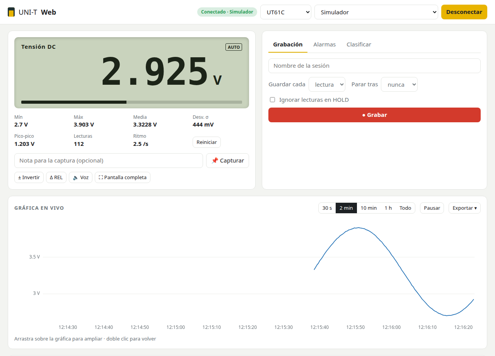

# UNI-T Web

Lee tu multímetro **UNI-T** (UT61C y compatibles) desde el navegador: valor en vivo, gráficas,
grabación, alarmas y exportación a CSV, JSON o PNG. **Sin instalar el software de UNI-T** y sin
servidor: todo se ejecuta en tu navegador y los datos no salen de tu ordenador.

### ▶ [Abrir UNI-T Web](https://fmesasc.github.io/uni-t-web/) · [Probar con el simulador (sin multímetro)](https://fmesasc.github.io/uni-t-web/?demo)



---

## Índice

1. [Qué necesitas](#qué-necesitas)
2. [Uso rápido](#uso-rápido)
3. [Preparar el ordenador: Windows, Linux y macOS](#preparar-el-ordenador)
4. [Ejemplos de uso](#ejemplos-de-uso)
5. [Funciones](#funciones)
6. [Problemas frecuentes](#problemas-frecuentes)
7. [Modelos compatibles](#modelos-compatibles)
8. [Usarlo sin internet](#usarlo-sin-internet) · [Desarrollo](#desarrollo)

---

## Qué necesitas

| | |
|---|---|
| **Navegador** | **Chrome, Edge, Chromium, Brave u Opera**, en escritorio. ❌ Firefox y Safari no sirven: no tienen las APIs WebHID ni Web Serial. |
| **Multímetro** | UT61C, UT61B, UT61D, UT61E, UT60A/E o la serie UT61+ (ver [modelos](#modelos-compatibles)). |
| **Cable** | El cable de PC del multímetro: óptico, que se encaja en la parte trasera del multímetro y va al USB. |

### ¿Qué cable tengo?

Hay dos tipos de cable USB, y en la web tienes que elegir el tuyo:

| Tipo | Cómo reconocerlo | En la web elige |
|---|---|---|
| **USB-serie** (chip Prolific PL2303, CH340, CP210x o FTDI) | En Linux crea `/dev/ttyUSB0`. En Windows aparece en *Puertos (COM y LPT)* del Administrador de dispositivos. | **Cable USB-serie** |
| **USB HID UT-D04** (chip WCH CH9325 o Hoitek HE2325U) | No crea ningún puerto COM ni `ttyUSB`. En Windows aparece en *Dispositivos de interfaz humana*. | **Cable USB HID** |
| **UT61B+/D+/E+, UT161** | El USB va directo al multímetro (chip CP2110). | **Cable USB HID** |

En Linux puedes salir de dudas con `lsusb`:

```
$ lsusb
Bus 001 Device 036: ID 067b:23a3 Prolific Technology, Inc. ATEN Serial Bridge   ← USB-serie
Bus 001 Device 012: ID 1a86:e008 QinHeng Electronics HID-based serial adapater  ← HID (UT-D04)
```

---

## Uso rápido

1. Conecta el cable al multímetro y al USB.
2. **Activa el envío de datos en el multímetro.** En el UT61B/C/D, **mantén pulsado `REL`** unos
   2 segundos hasta que aparezca `RS232` en la pantalla. Sin esto el multímetro no envía nada.
   Mientras está en `RS232`, el auto-apagado queda desactivado.
3. Abre **https://fmesasc.github.io/uni-t-web/** en Chrome o Edge.
4. Arriba, elige el **modelo** (p. ej. `UT61C`) y el **tipo de cable**.
5. Pulsa **Conectar**. El navegador te enseña una lista: elige tu cable (p. ej.
   *«USB-Serial Controller (ttyUSB0)»* o *«COM3»*) y pulsa *Conectar*.
6. Ya está: verás el valor en la pantalla y en la gráfica.

La próxima vez el navegador recordará el cable y conectará sin preguntar. Si desenchufas el
cable, la web se reconecta sola al volver a enchufarlo. Para elegir otro cable, usa el botón **⇄**.

---

## Preparar el ordenador

### Windows 10 / 11

- **Cable USB HID (UT-D04)**: no hace falta nada. Windows lo reconoce como dispositivo HID.
- **Cable USB-serie**: normalmente Windows instala el driver solo, por Windows Update. Compruébalo
  en el *Administrador de dispositivos* → *Puertos (COM y LPT)*: debe aparecer como *Prolific USB-to-Serial
  Comm Port (COM3)* o similar, **sin** triángulo amarillo. Si no aparece:
  - **Prolific PL2303**: instala el *PL2303 Windows Driver* desde la web de [Prolific](https://www.prolific.com.tw/) (sección de descargas).
    Si sale el error *"PL2303HXA PHASED OUT SINCE 2012"*, tu chip es antiguo y necesita el driver
    viejo 3.3.2.102.
  - **CH340/CH341**: driver *CH341SER* de [wch-ic.com](https://www.wch-ic.com/downloads/CH341SER_EXE.html).
  - **CP210x**: driver de [Silicon Labs](https://www.silabs.com/developers/usb-to-uart-bridge-vcp-drivers).
- Cierra el software de UNI-T si lo tienes abierto: un puerto COM solo puede usarlo un programa a la vez.

### Linux (Ubuntu, Debian, Fedora, Arch…)

Los drivers ya vienen en el kernel (`pl2303`, `ch341`, `cp210x`, `ftdi_sio`, `usbhid`). Lo que
hace falta son **permisos**, una sola vez:

**Cable USB-serie** (`/dev/ttyUSB0`): tu usuario tiene que estar en el grupo `dialout`.

```bash
sudo usermod -aG dialout $USER
# cierra sesión y vuelve a entrar (o reinicia) para que se aplique
```

**Cable USB HID (UT-D04) y serie UT61+**: instala la regla udev.

```bash
sudo curl -o /etc/udev/rules.d/70-uni-t.rules \
  https://raw.githubusercontent.com/fmesasc/uni-t-web/main/udev/70-uni-t.rules
sudo udevadm control --reload && sudo udevadm trigger
# desenchufa y vuelve a enchufar el cable
```

Otras notas de Linux:
- **Ubuntu y adaptadores CH340**: el paquete `brltty` (lectores braille) se apropia de estos
  adaptadores y el puerto desaparece al momento. Si no lo usas, quítalo con `sudo apt remove brltty`.
- **Chromium instalado como snap**: puede que también necesites `sudo snap connect chromium:raw-usb`.
  Con Google Chrome (`.deb`/`.rpm`) no hace falta.

### macOS

- **Cable USB HID (UT-D04)**: no hace falta nada.
- **Cable USB-serie**: macOS trae drivers para FTDI y CH340/CH341. Para **Prolific PL2303**,
  instala la app de Prolific (búscala como *PL2303Serial* en la Mac App Store) y autoriza la extensión en
  *Ajustes del Sistema → Privacidad y seguridad*. El puerto aparece como `cu.usbserial-…`.

### ChromeOS

Funciona sin hacer nada, con ambos tipos de cable.

---

## Ejemplos de uso

### 1. Registrar la descarga de una batería durante horas

1. Pon el multímetro en V DC y conéctalo a la batería.
2. Pestaña **Grabación**: nombre `Batería 18650 #2`, *Guardar cada* `10 s`, *Parar tras* `12 h`.
3. Pulsa **● Grabar**. Mientras graba, la pantalla no se apaga (deja la pestaña abierta).
4. Para que avise al llegar a la tensión de corte, en **Alarmas** pon *Mínimo* `3.0`, marca
   *Parar la grabación al dispararse* y pulsa *Activar alarma*.
5. Al acabar, en **Sesiones** haz clic en la sesión: verás la gráfica completa, mínimo, máximo y
   media, y la puedes descargar en **PNG**, **CSV** o **JSON**.

> Si mides **corriente DC**, el visor de la sesión calcula además la **carga** acumulada en mAh/Ah:
> la capacidad real de la batería.

### 2. Clasificar resistencias o condensadores

1. Pon el multímetro en Ω (o en capacidad).
2. Pestaña **Clasificar**: *Valor nominal* `10k`, *Tolerancia* `±5 %`, y marca *Captura automática
   al estabilizarse*. Pulsa *Activar*.
3. Mide cada pieza: cuando la lectura se estabiliza, suena un pitido (agudo si está **dentro** de
   tolerancia, grave si está **fuera**) y queda guardada en **Capturas** con su desviación. Separa
   las puntas entre pieza y pieza.
4. Exporta las capturas a CSV.

Los valores admiten sufijos: `4.7k`, `100n`, `2,2µ`, `220m`, `1M`.

### 3. Medir la caída de tensión respecto a una referencia

1. Mide el punto de referencia y pulsa **Δ REL** (o la tecla `R`).
2. A partir de ahí, debajo del valor verás la diferencia: `Δ -0.183 V (-3.62 %)`.

### 4. Puntas al revés

Si estás midiendo tensión o corriente DC con el rojo y el negro cambiados, pulsa **± Invertir**
(tecla `I`). No se pierde nada: el signo se corrige en todo lo que ya has medido (gráfica,
estadísticas, REL) y, si estás grabando, también en las lecturas ya guardadas de esa sesión. Las
nuevas lecturas llegan ya invertidas, y aparece `± INV` en la pantalla para que no se te olvide.
Pulsarlo otra vez lo deja todo como estaba.

¿Te diste cuenta después? Abre la sesión en **Sesiones** y pulsa **± Invertir sesión**.

### 5. Pasar los datos a Excel, LibreOffice o Google Sheets

- **Exportar ▾ → Copiar al portapapeles (tabla)** copia la zona visible de la gráfica con coma
  decimal, lista para pegar en una hoja de cálculo en español.
- O descarga el **CSV** (separado por comas y con punto decimal, el formato estándar).

### 6. Ver el valor desde lejos o sin mirar

- **⛶ Pantalla completa** (tecla `F`): números enormes, para leerlos desde el otro lado del banco.
- **🔈 Voz** (tecla `V`): lee el valor en voz alta cada vez que se estabiliza. Útil cuando tienes
  las dos manos ocupadas con las puntas.

---

## Funciones

- **Pantalla** como la del multímetro: modo, indicadores (AUTO, HOLD, REL, MAX, MIN, BAT) y barra.
- **Estadísticas** en vivo: mínimo, máximo, media, desviación típica, pico a pico y lecturas por segundo.
- **Gráfica en vivo** (30 s, 2 min, 10 min, 1 h o todo). Arrastra para ampliar y haz doble clic para volver.
  Si cambias de modo en el multímetro, la gráfica muestra el modo actual, pero los datos del
  anterior no se borran: vuelven al volver a ese modo. *Exportar ▾ → Vaciar gráfica* la limpia.
- **Exportar** la gráfica (PNG con título y estadísticas) y los datos (CSV, JSON, portapapeles).
- **Sesiones grabadas** con notas, intervalo de guardado, parada automática y opción de ignorar HOLD.
- **Capturas** puntuales con nota.
- **Δ REL**, **± Invertir**, **alarmas** (pitido, notificación, parar grabación), **clasificador**
  por tolerancia, **voz** y **pantalla completa**.
- **Copia de seguridad**: menú *💾 Datos* → descargar o restaurar todo en un JSON.
- **Reconexión automática** al volver a enchufar el cable, y aviso si el multímetro deja de enviar datos.

**Atajos de teclado**

| Tecla | Acción |
|---|---|
| `Espacio` | Capturar el valor actual |
| `R` | REL: fijar referencia o quitarla |
| `I` | Invertir polaridad |
| `V` | Voz |
| `F` | Pantalla completa |
| `P` | Pausar la gráfica |

> **Dónde se guardan los datos**: en el almacenamiento del navegador (IndexedDB), solo en ese
> navegador y ese ordenador. Si borras los datos de navegación de la web, se pierden: haz
> copias con *💾 Datos → Descargar copia de seguridad*.

---

## Problemas frecuentes

| Síntoma | Solución |
|---|---|
| Aviso amarillo *"Este navegador no puede acceder al USB"* | Estás en Firefox o Safari. Usa Chrome, Edge, Chromium, Brave u Opera. |
| Conecta, pero dice **"Sin datos — ¿multímetro encendido y en modo RS232?"** | Activa `RS232` en el multímetro (mantén pulsado `REL`). Comprueba que el cable está bien encajado en la parte trasera. |
| El cable **no aparece en la lista** del navegador | ¿Has elegido el tipo de cable correcto (USB-serie / HID)? Ver [¿Qué cable tengo?](#qué-cable-tengo). En Windows, revisa el driver. En Linux con CH340, quita `brltty`. |
| *"No se pudo abrir el dispositivo"* (Linux) | Faltan permisos: grupo `dialout` (serie) o regla udev (HID). Ver [Linux](#linux-ubuntu-debian-fedora-arch). |
| *"No se pudo abrir"* (Windows) | Otro programa tiene el puerto abierto (software de UNI-T, Arduino IDE…). Ciérralo. |
| *"The device has been lost"* con el cable enchufado (Linux) | Configura el puerto una vez con `stty -F /dev/ttyUSB0 2400 raw -echo clocal` y vuelve a conectar. |
| Los valores no tienen sentido | Comprueba que el **modelo** elegido coincide con tu multímetro. |
| Avisos en la consola sobre *"Serial blocklist"* y un ratón Bluetooth | Es normal: Chrome oculta esos dispositivos de la lista. No afecta. |

---

## Modelos compatibles

| Modelo | Protocolo | Estado |
|---|---|---|
| UT61B, **UT61C**, UT61D | FS9922-DMM4, 2400 8N1 | ✅ probado con UT61C y cable PL2303 |
| UT61E | ES51922, 19200 7O1 | ⚠️ sin probar con hardware |
| UT60A, UT60E | FS9721, 2400 8N1 | ⚠️ sin probar con hardware |
| UT61B+, UT61D+, UT61E+, UT161B/D/E | protocolo `AB CD` por petición, 9600 (CP2110) | 🧪 experimental |

Pendiente: UT71x, UT804 y UT372. Si tienes otro modelo y quieres ayudar, abre un *issue* con el
modelo, el tipo de cable y, si puedes, unos bytes de lo que envía.

---

## Usarlo sin internet

Es una web estática. Descárgala y sírvela en local: WebHID y Web Serial exigen `https` o `localhost`.

```bash
git clone https://github.com/fmesasc/uni-t-web
cd uni-t-web
python3 -m http.server 8000
# abre http://localhost:8000 en Chrome
```

---

## Desarrollo

No hay dependencias ni proceso de build: HTML, CSS y JavaScript sin módulos.

```
index.html        página
css/style.css
js/protocols.js   parsers FS9922, ES51922, FS9721 y UT61+ (también se usan desde Node)
js/drivers.js     WebHID (UT-D04, CP2110), Web Serial y simulador
js/db.js          almacenamiento en IndexedDB
js/app.js         interfaz
tests/            tests de protocolos y test de extremo a extremo
udev/             regla udev para Linux
```

```bash
node tests/protocols.test.js                    # tests de protocolos (o abre tests/index.html)
python3 -m http.server 8000                     # y abre http://localhost:8000/tests/e2e.html
```

Referencias de los protocolos: [libsigrok](https://github.com/sigrokproject/libsigrok)
(`src/dmm/fs9922.c`, `es519xx.c`, `fs9721.c`, `src/hardware/uni-t-dmm/`), los datasheets de los
chips, el software oficial de UNI-T (UT61C_D V3.03 / UT61E V4.01) y
[ljakob/unit_ut61eplus](https://github.com/ljakob/unit_ut61eplus) para la serie UT61+.

## Licencia

[MIT](LICENSE)
